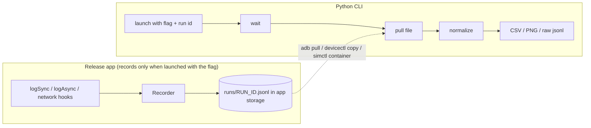

# react-native-flow-diagram (2.0.0)

Measure and visualize app startup flows of React Native apps (Android and iOS) from **release builds**.

Your app records structured events (`logSync`, `logAsync`, and network requests) into a per-launch JSON Lines (JSONL)
run file. A Python command line tool (CLI) launches the app N times on an emulator, simulator or physical device, pulls
the run files, and produces a CSV, averages and a PNG flow diagram.

Upgrading from 1.x? See the [migration guide](https://github.com/Pulimet/react-native-flow-diagram/blob/main/docs/v2/MIGRATION.md).
The [changelog](https://github.com/Pulimet/react-native-flow-diagram/blob/main/CHANGELOG.md) lists all changes.

## Concept



- The recorder is dormant unless the app is launched with the FlowDiagram flag (Android intent extra
  `FlowDiagramFlag`, iOS launch argument `--flowDiagramFlag`). Normal users never trigger it.
- Time zero (t0) is the **process start** by default, so the time before `Application.onCreate` or
  `didFinishLaunching` is visible too. The delay between process start and app init is shown as the first row.
- A SYNC event duration is the time since the previous SYNC event. ASYNC events and network requests are markers with
  no duration. A network response keeps its measured elapsed time.
- Network requests from native code and from React Native are captured automatically.
- Run file format: [schema](https://github.com/Pulimet/react-native-flow-diagram/blob/main/docs/v2/schema.md).

## Requirements

| Item | Needed for |
|---|---|
| Node.js, React Native 0.78 or newer (TurboModule) | the library |
| Python 3 | the CLI (`matplotlib` is installed by `npm run flow-setup`) |
| `adb` (Android platform tools) on `PATH` | Android emulator and device |
| Xcode with `xcrun simctl` | iOS simulator |
| Xcode with `xcrun devicectl` (Xcode 15 or newer) | iOS device |
| A trusted development certificate and Developer Mode on the phone | iOS device |

### Release builds only
Measure release builds, because debug builds are slower and not representative. The CLI stops with an error when it
detects a debuggable or Debug build (override with `--allow-debuggable`, numbers are then not representative).
Numbers for performance decisions should come from **physical devices**. Emulator and simulator reports are labeled
"functional, not representative".

- **Android**: install the `release` variant (R8 minification is fine, the library ships `consumer-rules.pro`). Any
  signing key works.
- **iOS device**: build with the **Release** configuration and **Development** signing. The development profile sets
  `get-task-allow`, which lets `devicectl` copy the run file from the app container. Ad-hoc or distribution signed
  builds do not allow this.
- **iOS simulator**: a Release build installed on the simulator.

## Installation

```shell
npm i react-native-flow-diagram
cd ios && pod install
```

### Android
1. `android/settings.gradle`:
    ```groovy
    include ':react-native-flow-diagram'
    project(':react-native-flow-diagram').projectDir = new File(rootProject.projectDir, '../node_modules/react-native-flow-diagram/android')
    ```
2. `android/app/build.gradle`: add `implementation project(':react-native-flow-diagram')` and sync Gradle.
3. `Application` class. `FlowDiagram.init` must be the **first line** of `onCreate`, so early events are captured:
    ```kotlin
    import net.alexandroid.flowdiagram.FlowDiagram

    override fun onCreate() {
        FlowDiagram.init(this)            // alwaysOn defaults to false
        super.onCreate()
        setupOkHttpClient()
        FlowDiagram.logSync("MainApplication.onCreate -> Start")
    }
    ```
   `FlowDiagram.init(context, alwaysOn = false)` starts buffering (up to 5,000 records) in memory. Pass `true` to record
   without the launch flag, for local development. Do not ship `alwaysOn = true`.
4. OkHttp interceptor for network capture:
    ```kotlin
    private fun setupOkHttpClient() {
        val okHttpClient = OkHttpClient.Builder()
            .cookieJar(ReactCookieJarContainer())
            .addInterceptor(FlowDiagram.interceptor)
            .build()
        OkHttpClientProvider.setOkHttpClientFactory { okHttpClient }
    }
    ```
5. Launch activity. **Required**: `onIntent` reads the flag. Call it from `onCreate` and `onNewIntent`:
    ```kotlin
    class MainActivity : ReactActivity() {
        override fun onCreate(savedInstanceState: Bundle?) {
            super.onCreate(savedInstanceState)
            FlowDiagram.onIntent(intent)
        }
        override fun onNewIntent(intent: Intent) {
            super.onNewIntent(intent)
            FlowDiagram.onIntent(intent)
        }
    }
    ```
   Without the flag the buffer is dropped and the recorder is a no-op for the rest of the process.

   Intent extras (the CLI sets them for you): `FlowDiagramFlag` (boolean), `FlowDiagramRunId` (string, letters,
   digits, `.`, `_`, `-`, max 128 characters) and `FlowDiagramSink=downloads` (force the Download fallback).
6. **R8 / ProGuard**: nothing to do. The library's `consumer-rules.pro` keeps `net.alexandroid.flowdiagram.**`. If you
   use custom rules that remove unused classes, keep that package too.

Native logging: `FlowDiagram.logSync(message)`, `FlowDiagram.logAsync(message)`, optional `logType` and `logLevel`
parameters, and `FlowDiagram.end()` (optional, writes `run_end` and stops recording).

### iOS
```swift
import FlowDiagramModule

class AppDelegate: RCTAppDelegate {
    override func application(_ application: UIApplication, didFinishLaunchingWithOptions launchOptions: [UIApplication.LaunchOptionsKey : Any]? = nil) -> Bool {
        FlowDiagram.onAppLaunched()   // alwaysOn: Bool = false; first line
        FlowDiagram.logSync(message: "AppDelegate.didFinishLaunchingWithOptions -> Start")
        // Remaining code
    }
}
```
- `onAppLaunched` reads `--flowDiagramFlag` and `--flowDiagramRunId <id>` from the launch arguments.
- Network capture is automatic (`URLSession` and React Native networking). No interceptor setup.
- Native logging: `FlowDiagram.logSync(message:logType:logLevel:)`, `FlowDiagram.logAsync(...)`, `FlowDiagram.end()`,
  `FlowDiagram.isRecording`.
- If iOS prewarmed the process (iOS 15+), t0 falls back to app init for that run (`prewarmed: true` in the header).

### JavaScript
```typescript
import {logAsync, logSync} from 'react-native-flow-diagram';

logSync('App.tsx -> Start (Sync RN Example)');
logAsync('App.tsx -> Network call successful (Async RN Example)');
```
| Function | Signature |
|---|---|
| `logSync` | `(msg: string, level?: LogLevel) => void` |
| `logAsync` | `(msg: string, level?: LogLevel) => void` |

`LogLevel` is `DEBUG` (default) or `INFO`, declared in the package's `NativeFlowDiagram` module. Duplicate messages are
numbered by the CLI, you do not need unique names.

## Python CLI

One time setup from the repository root:
```shell
npm run flow-setup
```
The `npm run flow:*` scripts use `modules/react-native-flow-diagram/py/.venv`. Flags go after `--`.

### Android (emulator or device)
Install the release build and keep a single device connected (or pass `--serial`).
```shell
npm run flow:android -- --launch_times 10
npm run flow:android -- --serial R5CT123 --package com.myapp --activity com.myapp.MainActivity --launch_times 10
```
The app is launched with `am start -W -S` and the flag. The run file is read from
`Android/data/<package>/files/flowdiagram/runs/`, with a fallback to `Download/flowdiagram/<package>/` (force it with
`--sink downloads`). The report also contains the system `TotalTime` from `am start -W`.

### iOS simulator
```shell
npm run flow:ios_simulator -- --bundle_id com.myapp --launch_times 10
```
Use `--udid <udid>` if several simulators are booted.

### iOS device
```shell
npm run flow:ios_device -- --bundle_id com.myapp --udid <udid> --launch_times 10
```
Install the Release build first (Xcode, or `xcrun devicectl device install app`). The CLI never installs or uninstalls.
**Do not uninstall the app between measurements**: the run files live in the app container.

### Without a device
```shell
npm run flow -- --from-dir output/<date>/raw
```

### Flags
| Flag | Default | Meaning |
|---|---|---|
| `--platform {android,ios_device,ios_simulator,auto}` | `android` | Target. `auto` picks the only ready target. |
| `--launch_times` | `1` | Number of cold launches. |
| `--output-dir` | `output` | Results directory. |
| `--package`, `--activity` | `com.flowdiagram`, `com.flowdiagram.MainActivity` | Android app. |
| `--bundle_id` | `org.reactjs.native.example.FlowDiagram` | iOS bundle id. |
| `--serial`, `--udid` | none | Pick a device when several are connected. |
| `--compile-mode {speed-profile,speed,verify,none}` | `speed-profile` | Android dexopt mode applied before measuring. `speed-profile` matches Play installs with a Baseline Profile. `none` keeps the current state. |
| `--t0 {process_start,app_init}` | `process_start` | Time origin. `app_init` gives numbers comparable with v1. |
| `--sink {auto,downloads}` | `auto` | Android run file location. |
| `--allow-debuggable` | off | Measure a debuggable or Debug build anyway. |
| `--wait_time` | `10` | Seconds to wait before the first fetch. |
| `--poll-interval`, `--stable-polls` | `1`, `2` | After the wait, fetch until the file ends with `run_end` or is unchanged for N polls. |
| `--timeout` | `60` | Hard limit per run in seconds. A partial file is used with a warning. |
| `--from-dir` | none | Rebuild reports from saved `*.jsonl` files. |
| `--open_csv`, `--open_png` | `False` | Open the results when done. |

Underscore and hyphen spellings of the flags are both accepted.

### Output
Under `<output-dir>/<yy-mm-dd>/`:
- `measure_<date>_<time>.csv`: averages per message (time, duration, min, max, all times), repeat count, and a footer
  with device, OS, build and t0.
- `measure_<date>_<time>_net.csv`: network requests and responses.
- `measure_<date>_<time>.png`: flow diagram.
- `raw/<run_id>.jsonl`: the raw run files, usable with `--from-dir`.

A failed iteration is skipped. The CLI exits with code 1 only if no run is usable.

## Troubleshooting

| Symptom | Fix |
|---|---|
| "No run file found" or a timeout | The app was built without the integration, `FlowDiagram.onIntent` is missing, or the app crashed. Increase `--wait_time`. |
| Android: no file in `Android/data` | Some OEMs block shell access. The CLI falls back to `Download/flowdiagram/<package>/`. Force it with `--sink downloads`. |
| Android: "secure lock" error | Unlock the device and disable the secure lock screen while measuring. A swipe lock is dismissed automatically. |
| Several Android or iOS targets | Pass `--serial` or `--udid`. |
| iOS device: launch failed | Unlock the phone, trust the computer, trust the developer certificate (Settings, General, VPN and Device Management), and enable Developer Mode. |
| iOS device: copy failed | The build must be Release with Development signing (`get-task-allow`). Distribution signing blocks container access. |
| "debuggable" error | Install the release variant, or pass `--allow-debuggable` for a non representative run. |
| Warning: request without response | The call failed or the device was offline (a failed call writes a request only). On an emulator or simulator, check that it has internet access. |
| Missing early events on Android | `FlowDiagram.init` must be the first line of `Application.onCreate`. |
| Stale data | Run files are matched by run id, so older files are rejected. The app keeps the newest 20 run files. |

## Store safety
The recorder is inert without the launch flag: it drops its buffer, writes no file, and later calls cost one boolean
check. Flags can only be set by `adb`, Xcode, `devicectl` or `simctl`, not by end users. `alwaysOn` is `false` by
default. Network URLs are written to app private storage only. To strip the recorder from store builds, guard the
`FlowDiagram.init` call and interceptor with a build flavor or `BuildConfig.DEBUG` (Android) or `#if !APPSTORE` (iOS).
Measured recording overhead on Android startup is about 0.6%.

## Development
Plan and phase notes: [`docs/v2/`](https://github.com/Pulimet/react-native-flow-diagram/tree/main/docs/v2). Python tests:
`cd modules/react-native-flow-diagram/py && .venv-test/bin/python -m pytest -q`. Android JVM tests:
`cd android && ./gradlew :react-native-flow-diagram:testReleaseUnitTest`.
