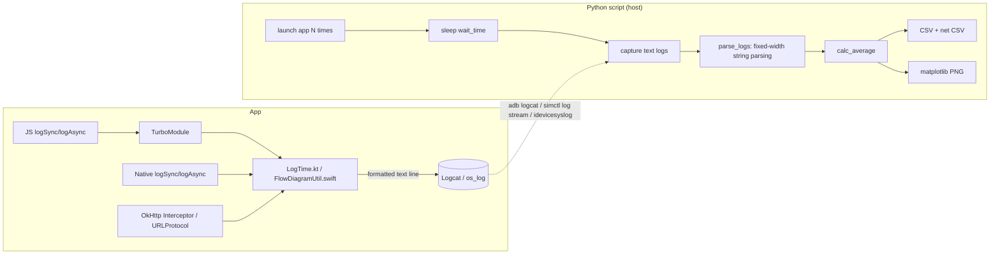
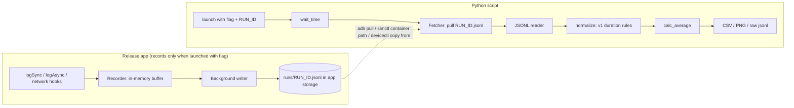

# FlowDiagram v2: In-app event recording, plan (rev 2)

## 0. Decisions (confirmed)
| # | Topic | Decision |
|---|---|---|
| 1 | Build type | Measure **release builds only** (Android and iOS). Dev-signed is allowed, but performance must match store builds. |
| 2 | v1 log mode | **Remove fully.** No Logcat / os_log based collection in v2. |
| 3 | Streaming | **Not needed.** Pull the file after each launch. |
| 4 | t0 | **Process start** (recommendation, see section 4.3), with app-init time also recorded so v1-style numbers stay available. |
| 5 | Durations | **No span API.** SYNC event duration = time since the previous SYNC event (same as v1). ASYNC and network request events have no inferred duration; network response keeps its measured elapsed time. |

## 1. How v1 works today



- **Emitters**: `LogTime` (Android), `FlowDiagramUtil` (iOS), TurboModule `FlowDiagram` (React Native, RN). Each event becomes a text line like
  `  1 234    => [RN][DEBUG][SYNC] App.tsx -> Render`. Timestamps are ms since `Application.onCreate` / `didFinishLaunching`.
- **Enable flag**: hardcoded `true` in host app, or Android intent extra `FlowDiagramFlag` (read only in `MainActivity`, so events from `Application.onCreate` are lost) or iOS launch arg `--flowDiagramFlag`.
- **Collection**: Android `adb logcat`, iOS Simulator `simctl log stream`, iOS device `idevicesyslog` (libimobiledevice, hardcoded app name) plus a `devicectl | grep | awk` PID hack to kill the app.
- **Parsing**: positional string slicing. SYNC duration = gap from previous SYNC event. Duplicate messages get `(n)` suffix in the app.
- **Output**: averages grouped by message, CSV, network CSV, timeline PNG.

### v1 pain points v2 fixes
| Problem | Cause |
|---|---|
| Lost or truncated events | log buffers, rate limiting, `os_log` privacy, capture window races |
| Fragile parsing | fixed-width text, platform-specific prefixes, hardcoded process names |
| Four different capture tools | logcat, log stream, idevicesyslog, plus libimobiledevice install |
| Early Android events dropped in flag mode | flag read in Activity after `Application.onCreate` |
| Cannot tell runs apart | logs from previous launches or other processes mix in |
| No raw data kept | only aggregated CSV/PNG saved |

## 2. v2 target architecture



Principle: the app records structured events to one file per launch; the script launches, waits, pulls one known file.

## 3. Transport interface (release builds)

Chosen: **file in app storage, pulled with stock SDK/Xcode tools**. No in-app server, no host server, no extra installs.

| Target | Where app writes | How script reads | Works with release build? |
|---|---|---|---|
| Android device (primary for perf numbers) | `getExternalFilesDir("flowdiagram")/runs/<runId>.jsonl` = `/sdcard/Android/data/<pkg>/files/flowdiagram/runs/` | `adb pull <path> <local>` then `adb shell rm` | Yes. Shell user can read `Android/data` without the app being debuggable. No permission needed by the app. |
| Android device fallback (if an OEM/OS blocks shell access to `Android/data`) | `MediaStore.Downloads` → `/sdcard/Download/flowdiagram/<pkg>/<runId>.jsonl` (no permission needed on Android 10+) | `adb pull` | Yes. Auto-selected by script if primary path is missing; app writes to both only if configured. |
| Android emulator | same as device | same | Yes (functional checks only, see 3.1) |
| iOS device (primary for perf numbers) | `<Documents>/flowdiagram/runs/<runId>.jsonl` | `xcrun devicectl device copy from --device <udid> --domain-type appDataContainer --domain-identifier <bundle> --source Documents/flowdiagram/runs/<runId>.jsonl --destination <local>` | Yes, when built with **Release configuration + Development signing** (development profile sets `get-task-allow`, which allows container access). Optimizations, bundled Hermes bytecode and no dev menu are identical to store builds. |
| iOS device, ad-hoc / distribution signed (optional) | same | `UIFileSharingEnabled=YES` in a perf-only Info.plist, read via `pymobiledevice3` (latest 11.63.1) house_arrest | Only if you need to test ad-hoc builds. Not in the default path. |
| iOS simulator | same | `xcrun simctl get_app_container booted <bundle> data` gives a macOS path, read directly | Yes (functional checks only) |

### 3.1 Release-realism rules (built into the script and docs)
- **Perf numbers come from physical devices only.** Emulator / simulator runs are allowed but the report is labeled "functional, not representative".
- **Android**
  - Install the `release` variant (R8 minified, `debuggable false`), signed with any key.
  - Replace the v1 forced `cmd package compile -m speed` with `--compile-mode` (default `speed-profile`, which matches Play installs with a Baseline Profile; options `speed`, `verify`, `none`). Cold start after `adb shell am force-stop` each iteration.
  - Library ships `consumer-rules.pro` so R8 keeps the recorder and TurboModule classes.
- **iOS**
  - Build with `Release` configuration, Development signing. Install via Xcode or `xcrun devicectl device install app`.
  - Launch with `devicectl` without `--console` (no debugger attached, which would slow startup).
- Script records build metadata (`versionName`, `debuggable`, configuration, signing type from header) and **warns or fails** when a debuggable / Debug build is detected.

### 3.2 Flag gating in store builds
The recorder is compiled into release builds but dormant: no file opened, one boolean check per call. Since store builds will contain it, gate activation so only a test launch can enable it:
- Android: flag accepted only via intent extra from `adb` launch. Option: `BuildConfig` flag `FLOW_DIAGRAM_ALLOWED` (true in release, can be turned off for store if desired).
- iOS: launch arguments can only be set by Xcode / `devicectl` / `simctl`, not by end users.
- Network URLs are written only to app-private storage (Android/data is not readable by other apps on Android 11+). Optional `redactQuery=true` strips query strings.

## 4. Native recorder design

### 4.1 Activation and run identity
- Script generates `run_id` (for example `20261124-083600-it03`) per launch:
  - Android: `adb shell am start -W -S -n <pkg>/<activity> --ez FlowDiagramFlag true --es FlowDiagramRunId <run_id>` (`-S` force-stops first, `-W` also gives system `TotalTime` as an extra metric). `monkey` launch removed.
  - iOS sim: `xcrun simctl launch --terminate-running-process booted <bundle> --flowDiagramFlag --flowDiagramRunId <run_id>`
  - iOS device: `xcrun devicectl device process launch --terminate-existing --device <udid> <bundle> -- --flowDiagramFlag --flowDiagramRunId <run_id>` (removes the PID grep hack).
- **Android early-events fix**: recorder buffers in memory from `Application.onCreate` (bounded, for example 5,000 events). When the launch Activity reads the intent: flag present, flush buffer to file and keep writing; flag absent, drop buffer and disable permanently for the process. Cost when disabled after that: one boolean check.
- iOS reads `ProcessInfo.arguments` in `onAppLaunched`, so it knows immediately.
- `alwaysOn = true` init parameter kept for local development; `run_id` then defaults to a timestamp.

### 4.2 Event format: JSON Lines (one JSON object per line)
```json
{"type":"run_start","schema":2,"run_id":"...","platform":"android","app_id":"com.flowdiagram","app_version":"1.0","build":"release","debuggable":false,"os":"14","device":"Pixel 8","t0":"process_start","app_init_ms":182.4,"prewarmed":false}
{"type":"event","seq":1,"t_ms":195.1,"src":"AD","mode":"SYNC","level":"DEBUG","msg":"MainApplication.onCreate -> Start","thread":"main"}
{"type":"net","seq":7,"t_ms":410.2,"phase":"REQ","req_id":3,"url":"https://..."}
{"type":"net","seq":9,"t_ms":702.9,"phase":"RSP","req_id":3,"url":"https://...","status":200,"dur_ms":292}
{"type":"run_end","seq":40,"t_ms":10012.0,"reason":"flush|background|buffer_limit"}
```
- `src`: `AD`, `IOS`, `RN`. `mode`: `SYNC` / `ASYNC`. Names match v1 so `calc_average`, CSV and PNG code barely change.
- Timestamps from a monotonic clock (`SystemClock.elapsedRealtimeNanos` / `clock_gettime(CLOCK_MONOTONIC_RAW)`), stored as ms with 0.1 ms precision.
- App stores raw events only. Duplicate `(n)` suffixing and duration calculation move to Python, so the rule lives in one place for all platforms.
- `req_id` pairs network request/response reliably (v1 matched by URL text).

### 4.3 t0 recommendation: process start
Why: in release builds a real part of cold start happens before `Application.onCreate` / `didFinishLaunching` (process fork, class loading / dyld, static initializers, `ContentProvider`s on Android, which libraries like Firebase use). v1 hid this. Users feel it, so the timeline should show it.

How:
- Android: `Process.getStartElapsedRealtime()` (API 24+); on API 33+ prefer `Process.getStartRequestedElapsedRealtime()` (includes zygote fork request).
- iOS: `sysctl(KERN_PROC_PID)` → `kp_proc.p_starttime`, converted to the monotonic clock at init.
- **iOS prewarming guard**: iOS 15+ may start the process before the user taps. If env `ActivePrewarm == "1"`, set `prewarmed:true` and fall back to t0 = `didFinishLaunching` for that run. Launches from `devicectl` are normally not prewarmed.
- Header stores `app_init_ms` (offset of `Application.onCreate` / `didFinishLaunching` from t0). The report adds a synthetic first row "Process start → App init" so the gap is visible, and `--t0 app_init` reproduces v1-comparable numbers.

### 4.4 Duration rules (same as v1, computed in Python `normalize.py`)
| Event | Duration |
|---|---|
| SYNC | `t_ms - t_ms of previous SYNC event` in the same run (first SYNC event: since t0) |
| ASYNC | 0 (drawn as a marker, as in v1) |
| NET REQ | 0 (marker) |
| NET RSP | `dur_ms` measured in the interceptor |

Averaging across runs is unchanged (group by message, average time and duration, min/max/all times).

### 4.5 Writer
- Single background thread (Android `HandlerThread`) / serial `DispatchQueue` (iOS), append-only, buffered; flush every 200 ms and on `onTrimMemory` / `applicationDidEnterBackground` / `willTerminate`.
- Script pulls the file **before** stopping the app, so force-stop cannot lose the tail. A partial last line is tolerated.
- Retention: on start keep the newest 20 run files. Script deletes pulled files on Android; on iOS retention handles it.
- Hot path does no I/O and no JSON encoding on the calling thread beyond building a small struct; encoding happens on the writer thread.
- Overhead budget verified in Phase 5: flag on vs flag off cold start delta under 2%.

### 4.6 Public API (version 2.0.0, breaking)
| Platform | v1 | v2 |
|---|---|---|
| Android | `LogTime.onApplicationOnCreate(bool)` + `LogTime.onIntent(intent)` | `FlowDiagram.init(context, alwaysOn = false)` (first line of `Application.onCreate`) + `FlowDiagram.onIntent(intent)` |
| Android network | `LogTime.loggingInterceptor` | `FlowDiagram.interceptor` |
| iOS | `FlowDiagramUtil.onAppLaunched(bool)` | `FlowDiagram.onAppLaunched(alwaysOn: Bool = false)` |
| RN | `logSync`, `logAsync` | unchanged |
| Native | `logSync`, `logAsync` | unchanged signatures |

`LogTime` / `FlowDiagramUtil` kept as deprecated aliases in 2.0 for easier migration, removed in 2.1.

## 5. Python script redesign

```
py/src/flow/
  main.py                 # orchestration only
  cli/cli_args.py         # + --compile-mode, --t0, --from-dir, --serial, --udid
  platforms/
    base.py               # Platform: validate, prepare, launch(run_id), fetch(run_id)->Path, stop, cleanup, build_info
    android.py            # adb: emulator + device, Android/data then Download fallback
    ios_simulator.py      # simctl + get_app_container
    ios_device.py         # devicectl
  events/
    model.py              # dataclasses RunHeader / Event / NetEvent
    reader.py             # JSONL -> events, schema check, partial-line tolerant
    normalize.py          # dup suffixes, v1 SYNC duration rule, req/rsp pairing -> v1 dict shape
  report/
    calc_average.py  csv_utils.py  visualize.py   # reused, plus build/device info in CSV footer and PNG title
```

Run loop per iteration:
1. `run_id = new_id()`
2. `platform.launch(run_id)` (launch commands force-stop first)
3. Sleep `wait_time`
4. `platform.fetch(run_id)` → `output/<date>/raw/<run_id>.jsonl`
5. `platform.stop()`; read, normalize; after all iterations aggregate and report.

Removed: `logcat_utils.py`, `ios_log_collector.py`, `ios_device_utils.get_pid`, `idevicesyslog` / libimobiledevice, positional parsing, `--extra` (flag is always passed; option kept as a no-op with a deprecation warning for one version).

Added: `--from-dir` regenerates reports from saved raw files without a device; pytest test suite; `matplotlib` pinned to latest stable 3.11.2.

## 6. Delivery phases

| Phase | Scope | Exit criteria |
|---|---|---|
| 0. Spike (1-2 days) | Hello-world file write + pull, **release builds**, on Android device (Android 11-15, at least one Samsung), iOS device (Release + Dev signing), emulator, simulator | Same file retrieved on all 4 targets without debuggable / Debug build |
| 1. Schema + Python reader (**done**, see `schema.md`) | JSONL schema v2, fixtures, `reader.py`, `normalize.py` (v1 duration rules), pytest | v1-style CSV/PNG produced from fixtures |
| 2. Android recorder (**done**, see `phase2-android.md`) | Buffer, writer, intent handling, process-start t0, interceptor with `req_id`, RN module, consumer R8 rules | Events from `Application.onCreate` present in flag mode, release + R8 |
| 3. iOS recorder (**done**, see `phase3-ios.md`) | Same in Swift, prewarm guard, `LoggingURLProtocol` with `req_id`, ObjC bridge | Output parity with Android |
| 4. Platform fetchers + run loop (**done**, see `phase4-python.md`) | `android.py`, `ios_simulator.py`, `ios_device.py`, `--compile-mode`, build checks, raw archiving | `npm run flow:<target>` works on 4 targets, N launches |
| 5. Hardening (**done**, see `phase5-hardening.md`) | Download fallback, multi-device `--serial/--udid`, overhead measurement, clear errors | Test matrix green, overhead under 2% |
| 6. Docs + release (**done**) | README v1 → v2 migration guide (`MIGRATION.md`), CHANGELOG, version 2.0.0 | Ready to publish (see CHANGELOG, not yet published) |

## 7. Test matrix (release builds)
| Target | Fetch works | Flag off: no file, no overhead | 10 launches | Early events (`Application.onCreate`) |
|---|---|---|---|---|
| Android device (2+ OEMs) | x | x | x | x |
| Android emulator | x | x | x | x |
| iOS device | x | x | x | x |
| iOS simulator | x | x | x | x |

Plus Python unit tests on JSONL fixtures: truncated last line, missing `run_end`, unmatched network request, duplicate messages, SYNC duration chain with interleaved ASYNC events.

## 8. Risks and mitigations
| Risk | Mitigation |
|---|---|
| OEM/OS blocks shell access to `Android/data` | MediaStore Downloads fallback, validated in Phase 0 |
| iOS container access needs Development signing | Documented build recipe (Release config + Dev signing); optional `UIFileSharingEnabled` + pymobiledevice3 path for ad-hoc |
| R8 strips or renames recorder classes | `consumer-rules.pro`, release build in CI of sample app |
| Recording changes measured startup | Writer off main thread, overhead measured flag on vs off |
| App killed before flush | Script pulls before stop; 200 ms flush |
| iOS prewarming distorts t0 | `ActivePrewarm` detection, fallback to app-init t0 |
| Multi-process Android apps | Process name in header, one file per process `<runId>-<proc>.jsonl` |
